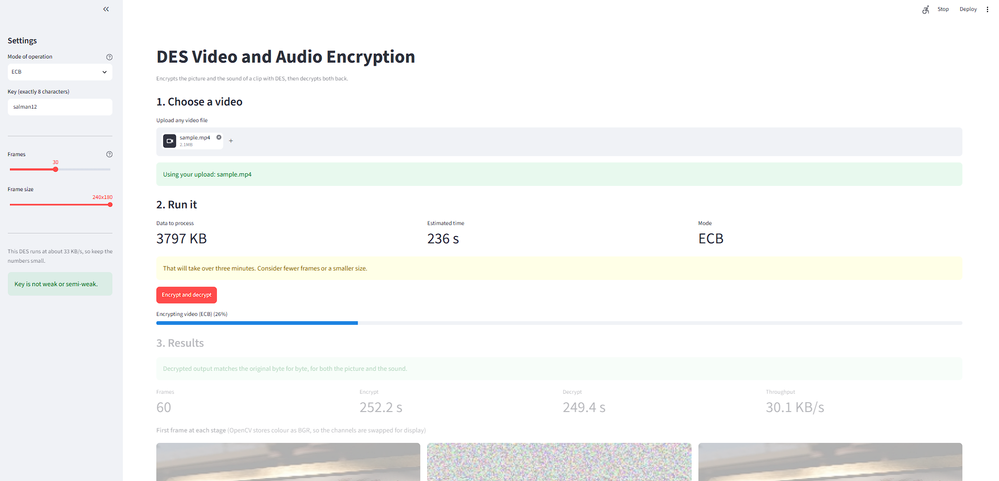
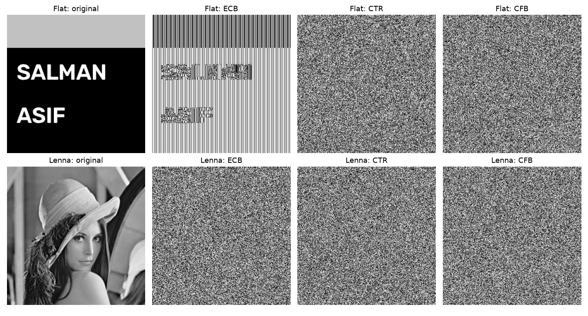

# DES Video and Audio Encryption

Encrypting both the picture and the sound of a video with DES, then decrypting
both back, and comparing three modes of operation.

Advanced Cryptography I, MSIS Semester 1.
Mian Salman Hassan and Muhammad Asif.



## What this does

A video file holds two separate streams, the picture and the sound. Encrypting
only the picture leaves the audio fully audible, so both are handled here.

- DES implemented from scratch, verified against the official test vector
  (key `133457799BBCDFF1`, plaintext `0123456789ABCDEF`, giving `85E813540F0AB405`).
- Three modes: ECB, CTR and CFB, with decryption for all three.
- Video frames and the audio track encrypted with the same key.
- A playable encrypted video: static on screen, static through the speakers.
- A browser interface for running it on any video file.

## Running it

```bash
pip install -r requirements.txt
python -m streamlit run app.py
```

The seven numbered scripts can also be run on their own:

| Script | What it does |
|---|---|
| `01_text_encryption.py` | Text, CTR round trip and single block decryption |
| `02_image_encryption.py` | Image encryption and decryption |
| `03_video_frames.py` | Video frames round trip |
| `04_audio_encryption.py` | Audio extraction, encryption, decryption |
| `05_full_pipeline.py` | Full pipeline, produces the playable videos |
| `06_mode_comparison.py` | Mode comparison figure |
| `07_security_analysis.py` | Entropy, correlation, key sensitivity |

`05_full_pipeline.py` takes any video:

```bash
python 05_full_pipeline.py "myvideo.mp4" 20 160 120
```

The numbers are frame count, width and height.

## Main finding



ECB encrypts every 8 byte block independently, so identical input blocks always
produce identical output blocks. The repetition structure survives, and that
structure is the leaked image. Measured duplicate 8 byte blocks:

| Data | Plaintext | ECB | CTR | CFB |
|---|---|---|---|---|
| Flat image with text | 7,673 of 8,192 | **7,673** | 0 | 0 |
| Lenna photograph | 32 of 8,192 | **32** | 0 | 0 |
| Video, 10 frames | 14,536 of 72,000 | **14,536** | 0 | 0 |

ECB keeps the count exactly. The second row is the interesting one: Lenna under
ECB looks like noise, because a detailed photograph rarely repeats the same 8
pixels. The mode is equally broken in both cases, which shows that an encrypted
image looking like noise is not evidence of security.

## Key sensitivity

| Keys | Bit changed | NPCR |
|---|---|---|
| `salman12` and `ralman12` | parity bit | **0.00%** |
| `salman12` and `qalman12` | real key bit | 99.57% |

Two different 8 byte keys, identical ciphertext. PC1 discards the lowest bit of
each key byte, so 8 of the 64 bits never reach the algorithm. This is DES's
56 bit effective key, demonstrated experimentally.

## Notes

- This DES runs at about 33 KB/s. That is the cost of an educational
  implementation storing each bit as a list element, not the speed of DES
  itself, which runs at tens of MB/s in C. Keep the frame counts small.
- The real ciphertext is `output/cipher/*.bin`. The MP4s are a viewable picture
  of it, since MP4 is lossy and would destroy ciphertext saved into it.
- DES should not be used for anything real. It was brute forced in 1998.
  This is a teaching exercise.
